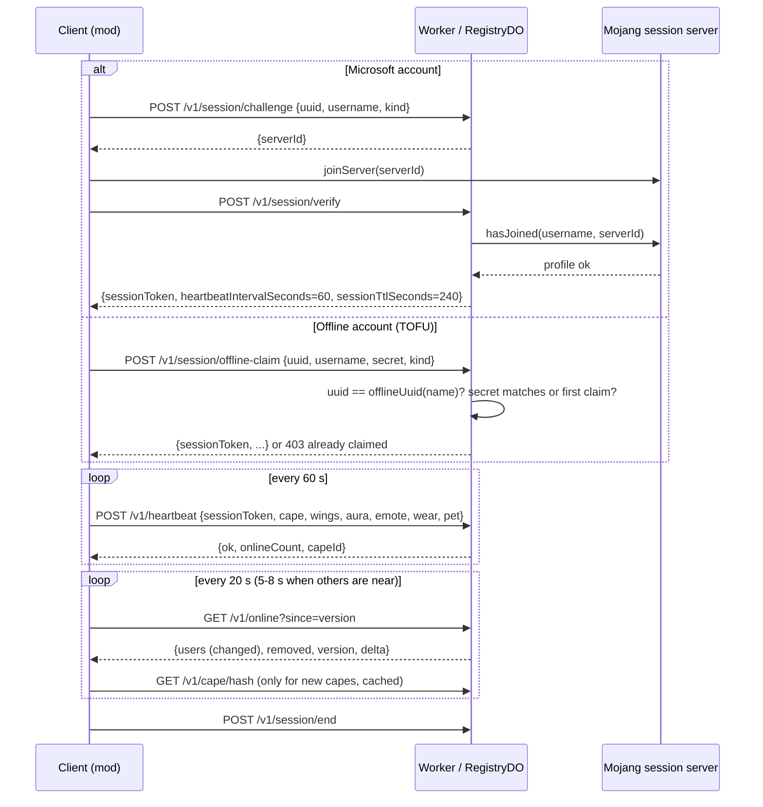
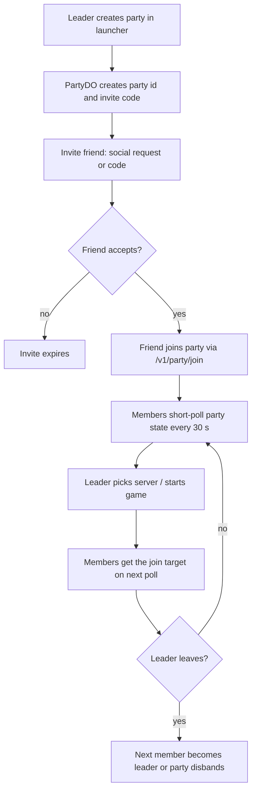

# Velo fork: context for whoever picks this up

Owner: Shaan (GitHub: Shaan4854). Fork: https://github.com/Shaan4854/velo-client, forked from velo345/velo-client.
Live progress is in `STATUS.md`. This file is the story and the reasoning. Both are updated at each milestone commit.

## 1. Hard rules from the owner

- Never delete, recreate or detach the fork. Never force-push.
- Do not touch `main` or publish releases without the owner's say-so (relayed by the Leader agent). Work goes on feature branches (`feat/workers-backend`, later `feat/offline-session`).
- Keep the three custom features intact: offline accounts, offline cosmetics, auto-updater pointed at this fork.
- No secrets in the repo or in logs. Tokens come from the vault and are never printed.

## 2. What the fork is

Velo Client is a Minecraft (Fabric) mod plus a desktop launcher, with an online service (`server/`) that provides sessions, who-is-online, cosmetics, capes, friends and parties. The fork adds features that upstream does not have:

1. **Offline accounts.** Players without a Microsoft account can use the launcher and game. No "Advent" button or popup is shown for offline accounts (gated with `!isOffline()` in `LauncherApp.java`, five places).
2. **Offline cosmetics.** `OfflineCosmetics` unlocks the store catalog locally for offline accounts (`StoreClient.owns()` returns true while `OfflineCosmetics.isActive()`), including the Velo cloak with local skins.
3. **Auto-updater pointing at the fork.** `AppUpdate.java` / `UpdateService.java` use `REPO=Shaan4854/velo-client` and a trust check (`velo-source.properties`, `Staged.UNTRUSTED`) so installs only follow this fork's releases.

## 3. The 1.6.0 merge

Upstream released 1.6.0. The fork was synced by merging upstream `main` into the fork's `main` (merge commit `f0d68d6`, fast-forward push, no force).

- Conflicts were only in the auto-updater files. Integrated: kept the fork's `REPO`, source file and trust check, and `isInstaller` (now uses `windowsInstallerFits`); took upstream's direct-unpack flow, retry helpers and logging.
- Regression found and fixed: upstream added two new Advent button spots in `LauncherApp.java` (topRow, homeTopRow). Both are gated with `!isOffline()`.
- Offline cosmetics: 1.6.0 added no new cosmetics (194 items before and after; price cuts only; 24 unreleased emotes removed). The unlock is generic so nothing needed changing.
- Upstream bug fixes: none were reported or cherry-picked beyond the merge itself. Nothing was dropped on purpose.
- Verification: launcher compile + tests on JDK 25; mod compiled locally for 1.21.11 and 1.21.1; GitHub Actions run 46101880822 built all 6 MC versions (1.21.1, 1.21.10, 1.21.11, 26.1, 26.2, 26.3) on 4 OS jobs.
- Unverified: no in-game runtime test was possible. UI placement of `OfflineCredits` and the offline cloak tiles after the upstream `VeloWindow`/`MenuKit` rework was not checked visually.

## 4. The release

`v1.6.0` was created on the fork at the owner's approval ("Release karde"), target `f0d68d6`. Tag run 46103506835 attached 10 assets (Windows installer and launcher exe, .deb, Linux tar.gz, macOS arm64/x64 dmg, 4 app zips). Old installs built after commit `99a3add` follow only this fork's releases.

## 5. The Workers backend

### Goal
Fork users, offline and Microsoft, should see each other's cosmetics, friends and parties, without depending on upstream's server (which would not serve offline accounts) and without a paid host.

### Decisions and reasoning

| Decision | Reasoning |
|---|---|
| Cloudflare Workers + Durable Objects, not a VM or Tunnel | Owner wants no VM to babysit and no home machine online. Workers free tier has no idle cost and a free `workers.dev` domain. A Tunnel needs an always-on machine. |
| No WebSockets | Free-tier Durable Object duration (13,000 GB-s/day) and request counts do not tolerate held connections for a group. Plain HTTP polling is cheap and the Java client already polls. |
| Throttled intervals: heartbeat 60 s, session TTL 240 s, online poll 20 s (adaptive), launcher poll 30 s | Free limit is 100k requests/day on Workers and on DO. Original intervals (heartbeat 20 s, poll 5 s) would use it up with a few dozen users. The server advertises the intervals; clients honor them. |
| Delta feed for `/v1/online` (`?since=version`) | Most polls return an empty delta: tiny responses and fewer rows read. |
| Durable Object with SQLite storage, not D1 | Free plan only offers SQLite-backed DOs. A single registry DO keeps sessions in memory with SQLite write-through, so most reads cost no rows. Row quotas (5M read, 100k written/day) are not the bottleneck. D1 would add a network hop per query for no gain at this scale. |
| One global `RegistryDO` for sessions/presence/capes | Presence must be consistent for everyone. At roughly 50 users with throttling this fits well inside one object. Social and party get their own DOs (M3). |
| Offline identity is trust on first use (TOFU) | Offline names have no authority to prove them. First claim of a name stores a hash of a client-generated secret; later claims need the same secret. The server also checks that the UUID equals the offline UUID of the name (MD5 of `OfflinePlayer:<name>`). Not strong security; stops casual impersonation. |
| Microsoft-verified names are reserved | A Microsoft verification (Mojang `hasJoined`) records the name as taken and deletes any offline claim on it, so an offline player cannot hold a name that a real account owns. |
| Cape limits: PNG only, at most 1.9 MB, width a multiple of 64 and at most 2048, height at most 1024, 2:1 or 1:1, one per player | Keeps storage and egress small on the free tier and matches what the renderer accepts. Capes are content-addressed and served with `immutable` cache headers so each download is cached. |
| Full cosmetics sharing, no ownership checks | The owner's call. He asserts he has prior permission from the upstream author (Velo2k). That claim is the owner's; it is not verified by us and the only written mention is a code comment in `OfflineCosmetics.java`. Logged here so it is visible. |
| Stubbed endpoints for features outside scope | Client-called routes that the fork does not implement (bans, reports, store, panel) return safe empty responses so the client does not error. (M3.) |
| Emote timing: server keeps an emote 30 s with a server timestamp (`emoteAtMillis`); client fast-polls only when others are around | Emotes ride the heartbeat as `id;seq`. Upstream's 12 s TTL is shorter than a throttled poll, so one-shot emotes would be missed. Not instant: expect roughly 2 to 8 s delay for others. True instant needs WebSockets, rejected above. |
| Same player, same session kind: new sign-in replaces the old session | Prevents ghost duplicates in the online list. |

### Wire compatibility
The Worker keeps upstream's JSON shapes (see `server/src/main/java/net/veloclient/server/`): errors `{"error": msg}`; verify returns `sessionToken`, `heartbeatIntervalSeconds`, `sessionTtlSeconds`; online users have `uuid, username, capeId, wingsId, auraId, plus, nameStyle, emote, wear, pet, og, petAct`. New fields are additive: `emoteAtMillis` and the `/v1/session/offline-claim` route.

### Diagrams

#### Architecture
```mermaid
flowchart LR
  subgraph Player machines
    M[Velo mod]
    L[Velo launcher]
  end
  M -- HTTPS --> W[Cloudflare Worker router]
  L -- HTTPS --> W
  W --> R[(RegistryDO: sessions, presence, capes, offline claims)]
  W --> S[(SocialDO: friends, DMs, requests) - M3]
  W --> P[(PartyDO: parties - M3)]
  R -. Microsoft login only .-> J[Mojang hasJoined]
```

#### Login, poll and heartbeat


#### Party flow (M3, planned)


## 6. Milestones

- M1 limits and design: done.
- M2 session and presence/cosmetics core in TypeScript, tested with `wrangler dev`: done on this branch (19 smoke checks pass, `workers-backend/test/smoke.mjs`).
- M3 social and party routes plus stubs: next.
- M4 client patches (default server URL, offline TOFU login in `VeloServerClient` and `LauncherSocial`, `OfflineCosmetics` coexistence, throttled intervals, emote fast poll), compile all targets.
- M5 deploy with `wrangler deploy` after the owner's Cloudflare login, then a test release build. The owner approves any release.

## 7. How to run the backend locally
```
cd workers-backend
npm install
npx wrangler dev --port 8799 --local
BASE=http://localhost:8799 node test/smoke.mjs
```
Sandbox notes: 1 CPU, 2 GB RAM. Mod/launcher builds need JDK 25 with `--no-daemon --no-configuration-cache --configure-on-demand --no-parallel -Dorg.gradle.jvmargs=-Xmx1400m`.
